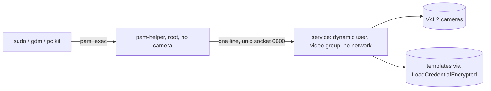

# ADR-0001 · A sandboxed service owns the cameras; PAM only asks it

| | |
| --- | --- |
| **Status** | Accepted |
| **Date** | 2026-11-09 |
| **Scope** | Where camera access, the networks and the face templates live at run time |
| **Out of scope** | What PAM does with the answer (ADR-0004), how templates are stored (ADR-0003) |

## Context

A PAM module runs inside whatever program asks for authentication: `sudo` and `polkit-agent-helper-1`
as root, the lock screen inside `gdm`. Reading cameras and running networks there would put a JPEG
decoder and a model runtime, both parsers of untrusted input, into root processes, and would load the
networks again for every attempt.

## Decision

1. A socket-activated service owns the cameras, the networks and the decrypted templates
   (`SYSTEMD/head-turn-face-unlock.socket`, `SYSTEMD/head-turn-face-unlock.service`).
2. PAM starts a small helper with `pam_exec` that sends one line and reads lines back
   (`SOURCE/head_turn_face_unlock/pam_helper.py`, `SOURCE/head_turn_face_unlock/protocol.py:18`
   limits a request to 1 KiB).
3. The socket is `0600` root and the service checks the peer uid with `SO_PEERCRED`
   (`SYSTEMD/head-turn-face-unlock.socket:8-10`, `SOURCE/head_turn_face_unlock/service.py:86-88`).
4. The service runs with nothing else: `DynamicUser=yes`, only the `video` group, only
   `char-video4linux`, no network, no address families, no writable executable memory, a system call
   filter and no other processes visible (`SYSTEMD/head-turn-face-unlock.service:17-49`).
5. It stays loaded between attempts and exits after `IDLE_EXIT_SECONDS` without requests.

## Consequences

- A decoder or runtime bug is confined to an unprivileged user with no network and no files to write.
  `systemd-analyze security head-turn-face-unlock.service` rates the unit 0.6 SAFE (measured on the
  development machine, commit `d899984`).
- The first attempt after the idle exit pays the model load, 0.67 s for the three networks (measured on
  the development machine with a warm file cache); later attempts do not.
- `ProcSubset=pid` had to stay off: it hides `/proc/cpuinfo`, and without it LiteRT's XNNPACK
  delegate does not start (journal: "Error in cpuinfo"; fixed in `d899984`).
- Two processes and a protocol instead of one function call: the protocol is tested on its own
  (`TESTS/test_protocol.py`, `TESTS/test_fuzz.py`).

## Options considered

- **Everything in the PAM process:** root parses camera data. Rejected.
- **A long-running daemon started at boot:** holds memory all day for a few unlocks. Rejected for
  socket activation with an idle exit.
- **D-Bus instead of a socket:** more attack surface and a broker in the path, for one request type.
  Rejected.

## Open questions

None.
