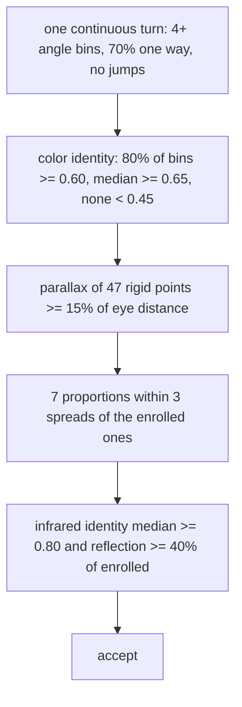

# ADR-0006 · Liveness and identity rules, from measurements

| | |
| --- | --- |
| **Status** | Accepted |
| **Date** | 2026-11-09 |
| **Scope** | What a turn of the head has to prove and every limit in `decision.py` |
| **Out of scope** | Certified presentation-attack detection; masks; look-alike relatives |

## Context

A face recognizer alone accepts a photograph. The camera has a color and an infrared sensor with an
emitter that blinks; the mesh (ADR-0005) gives three-dimensional landmarks. Every limit must come from a
measurement, not a guess.

## Decision

The person looks at the camera and turns the head once to one side. The judge checks, in this order
(`SOURCE/head_turn_face_unlock/decision.py:205-250`):

1. **The turn** (`decision.py:31-44`): angle bins of 10° from −40° to +40°, at least 20° to the side,
   at least 6 frames in 4 bins, 70% of steps one way, no gap over 6 frame intervals, no jump over 0.35
   face widths per interval, face size between 0.7 and 1.4 times its neighbour.
2. **Parallax** (`decision.py:53-54`, `SOURCE/head_turn_face_unlock/geometry.py:87`): the residual of
   the best homography between the 47 rigid points at the two ends of the turn, over the eye distance.
   A flat picture is one plane, so a homography explains it; a head is not.
3. **Proportions** (`decision.py:56-60`): seven ratios of the face measured in frontal frames, compared
   with the enrolled median within three enrolled spreads (at least 3%).
4. **Infrared** (`decision.py:47-49`): identity on infrared frames and the emitter's reflection inside the
   face outline, from a lit frame minus the unlit frame before it.
5. A value that could not be measured never helps: comparisons are written `not x >= limit`, so NaN
   refuses, and an unmeasured similarity counts as no match (`decision.py:253`).

## Consequences

Measurements behind the limits (owner's face, development machine):

| Quantity | Value |
| --- | --- |
| Landmark noise, still face | 1.1% of eye distance |
| Parallax, flat picture turned 10–30° (simulated with that noise) | at most 1.2% |
| Parallax, real head, 20–30° apart | 5th percentile 13.8% |
| Parallax, real head, full turns | 44–176% |
| Parallax in live unlocks after release | 51–60% |
| Proportions, frame to frame | 0.9–6.2% (forehead ratio 11%, dropped) |
| Color / infrared similarity in live unlocks | 0.82–0.93 / 0.87–0.96 |
| Whole unlock | 1.6–3.8 s |

- The 15% parallax limit sits between 1.2% for a picture and 44% for a real turn.
- The picture side comes from a simulation; a test with real photographs is still open.
- The rules were calibrated on one person.

## Options considered

- **Blink or smile challenges:** slow, and a video replays them. Rejected.
- **A depth camera:** needs structured light or time of flight; the infrared stream here is a plain grey
  image. Not possible on this hardware.
- **Five-point geometry (version 1):** cannot measure parallax reliably. Replaced by the mesh.

## Open questions

- Photograph and screen tests on the real camera. Proposed answer: run them before the next release and
  write the result in a new record; the owner postponed them on 2026-11-09.
