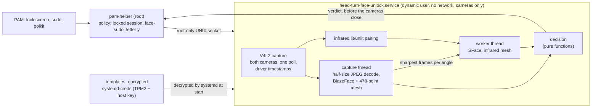

# Head-Turn Face Unlock

[Türkçe](README.tr.md)

Face unlock for Linux laptops that have an infrared camera next to the normal one (the kind sold for
"Windows Hello"). You turn your head from right to left. Both cameras follow the face with a
478-point 3D mesh through the whole turn: the face must match the enrolled one in color and in
infrared, keep its proportions, and move like a real three-dimensional head, which no photo or
screen can do. Whenever anything is missing or doubtful, the password is asked for exactly as before.

It works on the lock screen, with `sudo` (through `face-sudo`) and, on Debian-family systems, in
polkit dialogs. The login screen after a reboot always asks for the password.

Maintainer: Samed Emre Çetinkaya

## Disclaimer

This software takes part in authentication. A bug, a misconfiguration or a good enough imitation of
your face could let someone else in. It has no depth sensor and is not a certified biometric system;
it is a convenience, not a replacement for a strong password.

It has been tested on one machine only: an x86-64 laptop with a USB color and infrared camera, Debian 13,
GNOME 48 on Wayland and a Linux 7.2 kernel. The camera pipeline ran on that machine; installation, PAM
changes and removal ran as root in a throwaway virtual machine built from it. Behavior on other systems
is expected, not measured.

The software is provided "as is", without warranty of any kind. You use it at your own risk, and the
authors accept no liability for any damage or loss. Read the scripts before you install them, and keep a
root shell open the first time you try the lock screen. The [LICENSE](LICENSE) has the full terms.

## What a turn has to prove

| Check | Rule | Stops |
| --- | --- | --- |
| Head turn | From at least 20° to your right to at least 20° to your left, 70% of steps in one direction, through at least 4 of the 10° angle bins | A still photo, a face that is not turning |
| One unbroken track | Every frame shows exactly one face; no jump in position or size between frames | Two recordings spliced together, someone else leaning in |
| Three-dimensional motion | Between the two ends of the turn, the nose and the visible outline shift against each other by at least 15% of the eye distance | Printed photos and photos on a screen: a flat picture turned the same way stays under 2% |
| Color identity | In every angle bin the turn crosses, the sharpest frames match the enrolled face (80% of bins at 0.60 or more, median 0.65 or more, none below 0.45) | Other people |
| Proportions | Seven proportions of the face (height to width, nose length, nose and mouth width, brow to eye, jaw width, chin) stay within three enrolled spreads on the frames that look at the camera | Faces and masks of other proportions |
| Infrared identity | The infrared camera sees the face at least 4 times during the turn and it matches there too (median 0.80 or more) | Phone and laptop screens, which show nothing in infrared |
| Infrared reflection | The light the emitter adds inside the face outline reaches at least 40% of the enrolled level | Dark or non-reflecting imitations |

Every rule rejects unless its good condition holds, so a value that is not a number can only reject.
The similarity numbers come from the author's face: 0.69-0.91 in color and 0.80-0.94 in infrared for
the enrolled person, 0.21-0.25 for other people. They can be changed in the settings file.

## How it works



1. PAM runs `pam-helper` before the password. The helper decides whether the face may be tried at
   all: on the lock screen only while your graphical session is locked, with `sudo` only when
   `face-sudo` asked for it in the last ten seconds, in polkit only when you typed the single letter `y`.
2. The helper asks the service over a socket that only root can open. The service checks the
   caller's uid as well.
3. The service is started by its socket and stays loaded for ten minutes after the last request.
   systemd decrypts the enrolled templates into memory that only the service can read; the service
   never sees the key.
4. Both cameras stream at once. One thread reads both through a single `poll()`, decodes each color
   frame at half size inside libjpeg, finds the face with BlazeFace and its 478 landmarks with the
   Face Mesh. A second thread computes face embeddings, but only for the two sharpest frames of each
   angle bin, and runs the mesh on the lit infrared frames.
5. As soon as a turn is complete and its frames are analysed, the verdict goes back to PAM. The
   cameras are switched off after that, so the unlock does not wait for them.

Nothing is written to disk during a verification. Images are never stored; an enrollment keeps
128-number embeddings per angle, the infrared reflection level and seven proportions.

## Face geometry

Every frame of both cameras is described by the 478 points of MediaPipe's Face Mesh V2: the face
outline from forehead to chin, the brows, the eyelids and irises, the nose ridge, tip and wings, the
inner and outer lips. Each point has a depth as well as a position.

| Quantity | How it is computed | Measured on the author's machine |
| --- | --- | --- |
| Head pose | The face's x axis runs from its right to its left side (cheeks, outer eye corners and mouth corners averaged), its y axis from chin to forehead; their cross product is where the face looks. Yaw, pitch and roll follow in degrees | Agrees with the five-point estimate of version 1 at correlation 0.996 |
| Angle bins | Eight bins of 10° from 40° right to 40° left; each holds its own enrolled embeddings and is matched together with its neighbours | |
| Alignment | The recognizer aligns faces by five points, taken from the mesh: the iris centres, the nose tip and the mouth corners | |
| Three-dimensional motion | The 47 points that move with the skull (outline, nose ridge, eye corners; not lips, lids or brows) at the two ends of the turn. A flat picture, however it is turned, maps onto itself by a homography; a head does not. What the best homography leaves, over the eye distance, is the parallax | Landmark noise 1.1%; a flat picture turned 10-30° at most 1.2%; the real head 13.8% (5th percentile) for a 20-30° difference and 44-176% across full turns |
| Proportions | Seven ratios measured on frames within 10° of straight ahead | Frame-to-frame variation 0.9-6.2%; the forehead ratio varied 11% and is not used |
| Infrared reflection | The emitter's added light averaged inside the face outline of the infrared mesh | |

## How OpenCV and the models are used

| Stage | Choice | Measured |
| --- | --- | --- |
| Reading the cameras | Direct V4L2: the format is set once before streaming, both cameras are read by one `poll()`, the driver's timestamps are kept | Color camera's first frame 183 ms instead of 240-360 ms with OpenCV `VideoCapture`; infrared frames pair with color frames within 16 ms |
| JPEG decoding | `cv2.imdecode` with `IMREAD_REDUCED_COLOR_2`: libjpeg scales during the DCT. Full size only for frames chosen for recognition | 0.9 ms instead of 3.3 ms for decode plus resize |
| Finding the face | BlazeFace short range, run unchanged in LiteRT | 0.55 ms (1.3 ms with letterboxing); found the face in 96% of color frames, where YuNet found 89% in 6.3 ms |
| 478 landmarks | Face Mesh V2, run unchanged in LiteRT, on a crop rotated so the eyes are level | 1.9 ms |
| Recognition | OpenCV's SFace, only for the two sharpest frames per angle bin and for lit infrared frames, on a second thread | 14.7 ms per face |
| Infrared | Each lit frame is used once, with the unlit frame before it | Halved the infrared work of the first design |
| Whole frame | Decode, detection and mesh | About 4 ms of a 33 ms frame; during an attempt the service uses about 70% of one core, mostly for recognition |

The models run exactly as Google publishes them: LiteRT is Google's own runtime for them. Its wheel
is unpacked from PyPI without pip, pinned by SHA-256, and needs nothing but NumPy.

Tried and left out, with the numbers that decided it:

- **Converting the models to ONNX:** not needed once the official runtime is available, and every
  conversion has to be proven equal.
- **OpenCV's own TFLite importer:** distribution builds of OpenCV are compiled without it.
- **The `mediapipe` package:** it brings its own OpenCV and much more than two models.
- **The integrated GPU through OpenCL:** detection was slower (12 ms against 6.6 ms) and every start
  cost 200 ms more.
- **8-bit quantized models:** every threshold would have to be measured again.

The infrared camera's first frame arrives after about 350 ms whatever software reads it; that is the
remaining floor.

## Requirements

- 64-bit Linux on x86-64 or ARM64, systemd 250 or newer (`systemd-creds`, encrypted credentials loaded from a directory)
- Linux-PAM with `pam_exec`
- Python 3.10 to 3.14 (the versions LiteRT is published for), NumPy, and OpenCV 4.8 or newer with Python bindings
- A camera pair on one USB device: a color node with MJPG and an infrared node with 8-bit grey frames
  whose emitter lights every other frame
- A TPM2 chip is optional but recommended: templates are then bound to it

| Distribution | Packages | Note |
| --- | --- | --- |
| Debian 13, Ubuntu 24.10 or newer | `sudo apt install python3-opencv python3-numpy` | Ubuntu 24.04 ships OpenCV 4.6, which is too old |
| Fedora | `sudo dnf install python3-opencv python3-numpy` | |
| Arch Linux | `sudo pacman -S python-opencv python-numpy` | |

`SCRIPTS/INSTALL.sh` checks every requirement before it changes anything.

## Installation

```sh
git clone https://github.com/SamedEmreCetinkaya/HEAD_TURN_FACE_UNLOCK.git
sudo sh HEAD_TURN_FACE_UNLOCK/SCRIPTS/INSTALL.sh            # add --polkit for polkit dialogs
sudo head-turn-face-unlock enroll                            # about a minute
sudo head-turn-face-unlock test
```

The installer downloads the SFace model from the OpenCV Zoo, the Face Landmarker bundle from Google
and the LiteRT wheel from PyPI, and installs each only if its size and SHA-256 match the pinned
values. `--components DIRECTORY` uses local copies instead (checked the same way). PAM is changed
last, and only after the service answered. Each PAM file is backed up to
`/var/backups/head-turn-face-unlock` before it is changed. `--no-pam` leaves PAM alone.

Enrollments made with version 1 cannot be read by version 2 (the alignment and the stored
measurements changed); the installer says so, and `sudo head-turn-face-unlock enroll` makes a new one.

To remove everything (PAM is restored first): `sudo sh HEAD_TURN_FACE_UNLOCK/SCRIPTS/UNINSTALL.sh`.
Enrollments and settings stay unless you add `--purge`.

## Use

| Command | Does |
| --- | --- |
| `sudo head-turn-face-unlock enroll` | Enrolls your face, replacing an earlier enrollment |
| `sudo head-turn-face-unlock add` | Adds samples, for example with glasses or in other light. Only the enrolled face is accepted |
| `sudo head-turn-face-unlock test` | Verifies exactly as a login would. Details: `journalctl -u head-turn-face-unlock.service` |
| `sudo head-turn-face-unlock remove` | Deletes your enrollment |
| `sudo head-turn-face-unlock status` | Settings, service, cameras, models and who is enrolled |
| `face-sudo COMMAND` | `sudo` with the face; plain `sudo` keeps asking for the password |
| `python3 -IB SCRIPTS/SHOW_GEOMETRY.py` | A live window with the mesh, pose, parallax and proportions (as yourself, not root) |

On the lock screen, look at the camera and turn your head from right to left. If the infrared camera
cannot see you (it usually has a narrower view), you are told to tilt the screen.

The administration command always asks for the password, even right after another `sudo`: whoever
sits at an unlocked session must not be able to enroll their own face.

## Settings

`/etc/head-turn-face-unlock/HEAD_TURN_FACE_UNLOCK.conf`. An unknown key or a value out of range turns
face unlock off until it is fixed, so a typo never weakens a check silently.

| Key | Default | Meaning |
| --- | --- | --- |
| `LANGUAGE` | `en` | Messages: `en` or `tr` |
| `COLOR_CAMERA`, `INFRARED_CAMERA` | `auto` | `auto` finds the pair; or a device such as `/dev/video0` |
| `ATTEMPT_SECONDS` | `5` | How long one attempt may take |
| `IDLE_EXIT_SECONDS` | `600` | How long the service stays loaded after the last request |
| `MATCH_THRESHOLD` | `0.60` | Color similarity most angle bins must reach |
| `COLOR_MEDIAN_THRESHOLD` | `0.65` | Median color similarity over the bins |
| `MATCH_FLOOR` | `0.45` | No bin may be below this |
| `INFRARED_THRESHOLD` | `0.80` | Median infrared similarity |
| `ENROLL_SECONDS` | `120` | How long enrollment may take |

## Security

| Property | How |
| --- | --- |
| Fails toward the password | Every error, timeout or doubt ends the helper with a non-zero status; PAM then continues to the password. The PAM line is `[success=done default=ignore]` |
| The boot login keeps the password | The lock screen uses the face only while a graphical session is locked, so the keyring is still unlocked by the password |
| Face data stays encrypted | Templates are encrypted with `systemd-creds` (TPM2 and host key when there is a TPM) and are never written unencrypted: the service hands a new template to the root command over the socket, which pipes it into `systemd-creds` |
| Changing faces needs the password | A sudoers rule sets `timestamp_timeout=0` for the administration command |
| The camera process has nothing else | Dynamic user, member of `video` only, no network and no new sockets (it receives its socket from systemd), only camera devices, read-only system, no home directories, no other processes visible in `/proc`, no new privileges, no capabilities, a system call filter and no writable executable memory. `systemd-analyze security` rates it SAFE |
| Only root may ask | Socket mode 0600 in a 0700 directory, and the peer uid is checked |
| Inputs are parsed strictly | Settings, requests and templates reject unknown fields, repeated keys, numbers that are not finite and oversized input |
| Downloads are pinned | Models and the runtime are accepted only with their published size and SHA-256; the runtime is unpacked without running anything |

What it does not protect against: an attacker who is already root, a very good three-dimensional mask
or close relatives who look alike (not evaluated), and being forced to look at the camera. The
liveness checks were measured on one person and a simulated flat picture; they are not a certified
presentation-attack defence.

Please report vulnerabilities privately through GitHub (Security, Report a vulnerability). See
[SECURITY.md](SECURITY.md).

## Tests

```sh
make test     # unit and integration tests, no camera, no root, a few seconds
make lint     # ruff, mypy and shellcheck when they are installed
```

With `HEAD_TURN_FACE_UNLOCK_MODELS` and `HEAD_TURN_FACE_UNLOCK_RUNTIME` pointing at installed models
and LiteRT, the tests also run the real networks.

| File | Covers |
| --- | --- |
| `test_geometry.py` | Pose in degrees on a synthetic 3D head seen through a perspective camera, parallax of the head against a flat picture of it (with the measured landmark noise), alignment order, proportions, the face mask |
| `test_landmarks.py` | BlazeFace anchors and decoding, overlap removal, letterboxing, the rotated crop and its inverse, the real models when installed |
| `test_decision.py` | Every rule above: accepted turn, missing or reversed turns, too fast, zigzag, broken track, a flat picture turned like a head, other people, other proportions, NaN values, infrared too rare, mismatching or dark |
| `test_session.py` | Whole verifications and enrollments with scripted cameras and a synthetic head on a fake clock: the verdict is sent before the cameras close, timeouts, missing faces, cancelling, a blind infrared camera, adding another face |
| `test_template.py` | Round trip, size limit, and refusal of every malformed template |
| `test_service.py` | Socket service: other uids get nothing, malformed requests, missing or linked templates, broken models, idle exit, message language |
| `test_pam.py` | PAM line placement on Debian and Fedora files, installing twice, exact restore, the polkit file, the `face-sudo` marker, locked-session detection, the helper's answers to good, bad and silent services |
| `test_protocol.py` | Request parsing, line limits, timeouts, control characters |
| `test_v4l2_and_cameras.py` | ioctl numbers against `<linux/videodev2.h>`, row strides, camera pairing and mode choice |
| `test_vision.py` | Infrared reflection inside the outline, pairing, sharpness, decoding, model checksums, the real recognizer when installed |
| `test_config.py`, `test_cli.py` | The shipped settings and refusal of every kind of mistake; whose face a command changes |

Before release, the installer was also run as root in a throwaway virtual machine: install twice,
PAM untouched with `--no-pam`, socket mode, the sudoers rule, LiteRT unpacked and loaded inside the
service sandbox, a template encrypted with `systemd-creds` and decrypted by systemd for the service, a
corrupt template keeping the service down (logins use the password), the PAM change, `sudo` with the
right and the wrong password, `face-sudo` reaching the service and falling back to the password, and
removal restoring every PAM file exactly.

## Known limits

- Infrared cameras whose emitter is always on are not supported yet: the reflection check needs an unlit frame.
- The proportions check and the parallax limit were calibrated on one person; the flat-picture side of
  the parallax limit comes from a simulation with the measured noise, not from photographs yet.
- polkit support is installed only on Debian-family systems with the plain `pam_unix` stack, because
  the password module must reuse what was typed into the first prompt.
- Messages on the lock screen come through `pam_exec`; some desktops show them only when the attempt ends.
- Only English and Turkish messages.

## Repository

| Path | Contents |
| --- | --- |
| `SOURCE/head_turn_face_unlock/` | The Python package: capture, cameras, landmarks, geometry, vision, decision, session, service, PAM helper, CLI |
| `SOURCE/ENTRY/` | Installed entry points and `face-sudo` |
| `SYSTEMD/` | Socket and service units |
| `CONFIG/` | Default settings |
| `SCRIPTS/` | Install, uninstall, component download, PAM editing, the live geometry window |
| `TESTS/` | Unit and integration tests |

## Naming

| Item | Format | Example |
| --- | --- | --- |
| Project, directories, configuration, scripts, keys, constants | `UPPER_SNAKE_CASE` | `HEAD_TURN_FACE_UNLOCK.conf`, `MATCH_THRESHOLD` |
| Installed commands and units, as FHS and systemd expect | `lower-kebab-case` | `head-turn-face-unlock.service` |
| Python modules, functions and variables | `lower_snake_case` | `pam_helper.py` |
| Standard project files | Conventional | `README.md`, `Makefile`, `LICENSE` |

## Credits

- [MediaPipe Face Landmarker](https://ai.google.dev/edge/mediapipe/solutions/vision/face_landmarker): BlazeFace short range and Face Mesh V2, Apache License 2.0 (model cards)
- [LiteRT](https://ai.google.dev/edge/litert), Apache License 2.0
- [SFace](https://github.com/opencv/opencv_zoo/tree/main/models/face_recognition_sface) face recognizer, Apache License 2.0
- [OpenCV](https://opencv.org/)

The models and the runtime are downloaded at installation and are not part of this repository.

## License

MIT. See [LICENSE](LICENSE).
