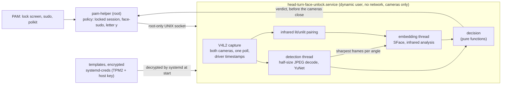

# Head-Turn Face Unlock

Face unlock for Linux laptops that have an infrared camera next to the normal one (the kind sold for
"Windows Hello"). You turn your head from right to left. Through the whole turn the color camera and
the infrared camera must both see the enrolled face, without a break, and the infrared light must
reflect from it the way it reflects from a real head. Whenever anything is missing or doubtful, the
password is asked for exactly as before.

It works on the lock screen, with `sudo` (through `face-sudo`) and, on Debian-family systems, in
polkit dialogs. The login screen after a reboot always asks for the password.

Maintainer: Samed Emre Çetinkaya

## Disclaimer

This software takes part in authentication. A bug, a misconfiguration or a good enough imitation of
your face could let someone else in. It has no depth sensor and is not a certified biometric system;
it is a convenience, not a replacement for a strong password.

It has been tested on one machine only: an x86-64 laptop with a USB color and infrared camera, Debian 13,
GNOME 48 on Wayland and a Linux 7.2 kernel. The camera pipeline ran on that machine; installation, PAM
changes and removal ran as root in a throwaway virtual machine built from it. Behavior on other systems
is expected, not measured.

The software is provided "as is", without warranty of any kind. You use it at your own risk, and the
authors accept no liability for any damage or loss. Read the scripts before you install them, and keep a
root shell open the first time you try the lock screen. The [LICENSE](LICENSE) has the full terms.

## What a turn has to prove

| Check | Rule | Stops |
| --- | --- | --- |
| Head turn | From at least 0.30 to your right to at least 0.30 to your left (yaw index, about 20°), 0.60 in all, 70% of steps in one direction, at least 4 angle bins | A still photo, a face that is not turning |
| One unbroken track | No frame without the face or with a second face, no jump in position or size between frames | Two recordings spliced together, someone else leaning in |
| Color identity | In every angle bin the turn crosses, the sharpest frames must match the enrolled face (80% of bins at 0.60 or more, median 0.65 or more, none below 0.45) | Other people |
| Infrared identity | The infrared camera must see the face at least 4 times during the turn and match it (median 0.80 or more) | Phone and laptop screens, which show nothing in infrared |
| Infrared reflection | The light the emitter adds must reach at least 40% of the enrolled level and the nose must reflect like the enrolled nose | Paper, masks with a different surface |
| Depth cue | The infrared brightness centroid must move with the turn like the enrolled head's | Flat pictures, which do not shade as they turn |

Every rule rejects unless its good condition holds, so a value that is not a number can only reject.
The numbers are measurements from the author's face: 0.69-0.91 in color and 0.87-0.94 in infrared for
the enrolled person, 0.21-0.25 for other people. They can be changed in the settings file.

## How it works



1. PAM runs `pam-helper` before the password. The helper decides whether the face may be tried at
   all: on the lock screen only while your graphical session is locked, with `sudo` only when
   `face-sudo` asked for it in the last ten seconds, in polkit only when you typed the single letter `y`.
2. The helper asks the service over a socket that only root can open. The service checks the
   caller's uid as well.
3. The service is started by its socket and stays loaded for ten minutes after the last request.
   systemd decrypts the enrolled templates into memory that only the service can read; the service
   never sees the key.
4. Both cameras stream at once. One thread reads both through a single `poll()`, decodes each color
   frame at half size inside libjpeg and finds the face. A second thread computes face embeddings,
   but only for the two sharpest frames of each angle bin and for the lit infrared frames.
5. As soon as a turn is complete and its frames are analysed, the verdict goes back to PAM. The
   cameras are switched off after that, so the unlock does not wait for them.

Nothing is written to disk during a verification. Images are never stored; an enrollment keeps only
128-number embeddings per angle.

## Measurements

Measured on the author's machine (Core Ultra 7 255H, OpenCV 4.10, under normal desktop load). The
ratios matter more than the absolute numbers.

| Stage | Usual approach | This project | Why |
| --- | --- | --- | --- |
| Python, OpenCV and both models | 330 ms for every attempt | Once, then kept for 10 minutes | A service started by its socket |
| 1280x720 JPEG to 640x360 | 3.3 ms (decode, then resize) | 0.9 ms | libjpeg scales during the DCT. Landmarks move 0.5 px; embeddings agree at cosine 0.996 |
| Face embedding | Every frame, 14.7 ms each | Only the frames the decision needs | The sharpest two per angle bin |
| Infrared frames | Each lit frame analysed twice (with the unlit frame before and after) | Once | CPU during an attempt fell from 131% to 72% of one core |
| Color camera start (first frame) | 240-360 ms with OpenCV `VideoCapture` | 183 ms | Format set once before streaming starts |
| Pairing color and infrared | Time a Python thread read the frame | Driver timestamps | Pairs are at most 16 ms apart |

Tried and left out, with the numbers that decided it:

- **Detecting only around the last face:** 5 times cheaper, but the landmarks changed enough to drop
  embedding agreement to 0.88-0.95, which would lower every match.
- **The integrated GPU through OpenCL:** detection took 12 ms instead of 6.6 ms, embeddings 9.2 ms
  instead of 14.7 ms, and every start cost 200 ms more.
- **8-bit quantized models:** smaller and faster, but every threshold would have to be measured again.

The infrared camera's first frame arrives after about 350 ms whatever software reads it; that is the
remaining floor. While a verification runs, the service uses about 330 MiB of memory.

## Requirements

- 64-bit Linux with systemd 250 or newer (`systemd-creds`, encrypted credentials loaded from a directory)
- Linux-PAM with `pam_exec`
- Python 3.10 or newer, NumPy, and OpenCV 4.8 or newer with Python bindings
- A camera pair on one USB device: a color node with MJPG and an infrared node with 8-bit grey frames
  whose emitter lights every other frame
- A TPM2 chip is optional but recommended: templates are then bound to it

| Distribution | Packages | Note |
| --- | --- | --- |
| Debian 13, Ubuntu 24.10 or newer | `sudo apt install python3-opencv python3-numpy` | Ubuntu 24.04 ships OpenCV 4.6, which is too old |
| Fedora | `sudo dnf install python3-opencv python3-numpy` | |
| Arch Linux | `sudo pacman -S python-opencv python-numpy` | |

`SCRIPTS/INSTALL.sh` checks every requirement before it changes anything.

## Installation

```sh
git clone https://github.com/SamedEmreCetinkaya/HEAD_TURN_FACE_UNLOCK.git
sudo sh HEAD_TURN_FACE_UNLOCK/SCRIPTS/INSTALL.sh            # add --polkit for polkit dialogs
sudo head-turn-face-unlock enroll                            # about a minute
sudo head-turn-face-unlock test
```

The installer downloads the two models from the OpenCV Zoo and installs them only if their SHA-256
matches the published files. `--models DIRECTORY` uses local copies instead (checked the same way).
PAM is changed last, and only after the service answered. Each PAM file is backed up to
`/var/backups/head-turn-face-unlock` before it is changed. `--no-pam` leaves PAM alone.

To remove everything (PAM is restored first): `sudo sh HEAD_TURN_FACE_UNLOCK/SCRIPTS/UNINSTALL.sh`.
Enrollments and settings stay unless you add `--purge`.

## Use

| Command | Does |
| --- | --- |
| `sudo head-turn-face-unlock enroll` | Enrolls your face, replacing an earlier enrollment |
| `sudo head-turn-face-unlock add` | Adds samples, for example with glasses or in other light. Only the enrolled face is accepted |
| `sudo head-turn-face-unlock test` | Verifies exactly as a login would. Details: `journalctl -u head-turn-face-unlock.service` |
| `sudo head-turn-face-unlock remove` | Deletes your enrollment |
| `sudo head-turn-face-unlock status` | Settings, service, cameras, models and who is enrolled |
| `face-sudo COMMAND` | `sudo` with the face; plain `sudo` keeps asking for the password |

On the lock screen, look at the camera and turn your head from right to left. If the infrared camera
cannot see you (it usually has a narrower view), you are told to tilt the screen.

The administration command always asks for the password, even right after another `sudo`: whoever
sits at an unlocked session must not be able to enroll their own face.

## Settings

`/etc/head-turn-face-unlock/HEAD_TURN_FACE_UNLOCK.conf`. An unknown key or a value out of range turns
face unlock off until it is fixed, so a typo never weakens a check silently.

| Key | Default | Meaning |
| --- | --- | --- |
| `LANGUAGE` | `en` | Messages: `en` or `tr` |
| `COLOR_CAMERA`, `INFRARED_CAMERA` | `auto` | `auto` finds the pair; or a device such as `/dev/video0` |
| `ATTEMPT_SECONDS` | `5` | How long one attempt may take |
| `IDLE_EXIT_SECONDS` | `600` | How long the service stays loaded after the last request |
| `MATCH_THRESHOLD` | `0.60` | Color similarity most angle bins must reach |
| `COLOR_MEDIAN_THRESHOLD` | `0.65` | Median color similarity over the bins |
| `MATCH_FLOOR` | `0.45` | No bin may be below this |
| `INFRARED_THRESHOLD` | `0.80` | Median infrared similarity |
| `ENROLL_SECONDS` | `120` | How long enrollment may take |

## Security

| Property | How |
| --- | --- |
| Fails toward the password | Every error, timeout or doubt ends the helper with a non-zero status; PAM then continues to the password. The PAM line is `[success=done default=ignore]` |
| The boot login keeps the password | The lock screen uses the face only while a graphical session is locked, so the keyring is still unlocked by the password |
| Face data stays encrypted | Templates are encrypted with `systemd-creds` (TPM2 and host key when there is a TPM) and are never written unencrypted: the service hands a new template to the root command over the socket, which pipes it into `systemd-creds` |
| Changing faces needs the password | A sudoers rule sets `timestamp_timeout=0` for the administration command |
| The camera process has nothing else | Dynamic user, member of `video` only, no network and no new sockets (it receives its socket from systemd), only camera devices, read-only system, no home directories, only its own processes in `/proc`, no new privileges, no capabilities, a system call filter and no writable executable memory. `systemd-analyze security` rates it SAFE |
| Only root may ask | Socket mode 0600 in a 0700 directory, and the peer uid is checked |
| Inputs are parsed strictly | Settings, requests and templates reject unknown fields, repeated keys, numbers that are not finite and oversized input |
| Downloads are pinned | Models are accepted only with the published SHA-256 |

What it does not protect against: an attacker who is already root, a very good three-dimensional mask
or close relatives who look alike (not evaluated), and being forced to look at the camera. The infrared
liveness checks are heuristics measured on one person, not a certified presentation-attack defence.

Please report vulnerabilities privately through GitHub (Security, Report a vulnerability). See
[SECURITY.md](SECURITY.md).

## Tests

```sh
make test     # 109 tests, no camera, no root, a few seconds
make lint     # ruff, mypy and shellcheck when they are installed
```

Before release, the installer was also run as root in a throwaway virtual machine (26 checks): install
twice, PAM untouched with `--no-pam`, socket mode, the sudoers rule, a template encrypted with
`systemd-creds` and decrypted by systemd for the service, a corrupt template keeping the service down
(logins use the password), the PAM change, `sudo` with the right and the wrong password, `face-sudo`
reaching the service and falling back to the password, and removal restoring every PAM file exactly.

| File | Covers |
| --- | --- |
| `test_decision.py` | Every rule above with synthetic turns: accepted turn, missing or reversed turns, too fast, zigzag, broken track, other people, NaN values, infrared too rare, flat or dark reflection, wrong depth cue |
| `test_session.py` | Whole verifications and enrollments with scripted cameras and models on a fake clock: the verdict is sent before the cameras close, timeouts, cancelling, a blind infrared camera, adding another face |
| `test_template.py` | Round trip, size limit, and refusal of every malformed template |
| `test_service.py` | Socket service: other uids get nothing, malformed requests, missing or linked templates, broken models, idle exit, message language |
| `test_pam.py` | PAM line placement on Debian and Fedora files, idempotence, exact restore, the polkit file, the `face-sudo` marker, locked-session detection, the helper's answers to good, bad and silent services |
| `test_protocol.py` | Request parsing, line limits, timeouts, control characters |
| `test_v4l2_and_cameras.py` | ioctl numbers against `<linux/videodev2.h>`, row strides, camera pairing and mode choice |
| `test_vision.py` | Head angle, infrared profile (including a nose outside the face box), pairing, sharpness, decoding, model checksums; with `HEAD_TURN_FACE_UNLOCK_MODELS` set, the real models |
| `test_config.py` | The shipped settings, and refusal of every kind of mistake |
| `test_cli.py` | Whose face a command changes: `--user`, the person who ran `sudo`, the login account in a root shell |

## Known limits

- Infrared cameras whose emitter is always on are not supported yet: the liveness checks need an unlit frame.
- polkit support is installed only on Debian-family systems with the plain `pam_unix` stack, because
  the password module must reuse what was typed into the first prompt.
- Messages on the lock screen come through `pam_exec`; some desktops show them only when the attempt ends.
- Only English and Turkish messages.

## Repository

| Path | Contents |
| --- | --- |
| `SOURCE/head_turn_face_unlock/` | The Python package: capture, cameras, vision, decision, session, service, PAM helper, CLI |
| `SOURCE/ENTRY/` | Installed entry points and `face-sudo` |
| `SYSTEMD/` | Socket and service units |
| `CONFIG/` | Default settings |
| `SCRIPTS/` | Install, uninstall, model download, PAM editing |
| `TESTS/` | Unit and integration tests |

## Naming

| Item | Format | Example |
| --- | --- | --- |
| Project, directories, configuration, scripts, keys, constants | `UPPER_SNAKE_CASE` | `HEAD_TURN_FACE_UNLOCK.conf`, `MATCH_THRESHOLD` |
| Installed commands and units, as FHS and systemd expect | `lower-kebab-case` | `head-turn-face-unlock.service` |
| Python modules, functions and variables | `lower_snake_case` | `pam_helper.py` |
| Standard project files | Conventional | `README.md`, `Makefile`, `LICENSE` |

## Credits

- [YuNet](https://github.com/opencv/opencv_zoo/tree/main/models/face_detection_yunet) face detector, MIT License
- [SFace](https://github.com/opencv/opencv_zoo/tree/main/models/face_recognition_sface) face recognizer, Apache License 2.0
- [OpenCV](https://opencv.org/)

The models are downloaded at installation and are not part of this repository.

## License

MIT. See [LICENSE](LICENSE).
