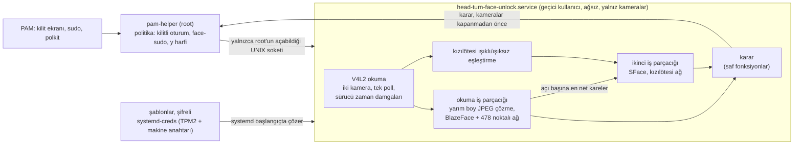

# Head-Turn Face Unlock (Baş Çevirerek Yüz Kilidi)

[English](README.md)

Normal kameranın yanında kızılötesi (IR) kamerası olan Linux dizüstüleri için yüz kilidi ("Windows
Hello" için satılan türden kameralar). Başınızı sağdan sola çevirirsiniz. İki kamera da dönüş
boyunca yüzü 478 noktalı 3B bir ağla izler: yüz, renkli görüntüde ve kızılötesinde kayıtlı yüzle
eşleşmeli, oranlarını korumalı ve gerçek, üç boyutlu bir baş gibi hareket etmelidir; hiçbir fotoğraf
ya da ekran bunu yapamaz. Bir şey eksik ya da şüpheli olduğunda şifre her zamanki gibi sorulur.

Kilit ekranında, `sudo` ile (`face-sudo` üzerinden) ve Debian ailesi sistemlerde polkit
pencerelerinde çalışır. Yeniden başlatmadan sonraki giriş ekranı her zaman şifre ister.

Geliştirici: Samed Emre Çetinkaya

## Sorumluluk reddi

Bu yazılım kimlik doğrulamada rol alır. Bir hata, yanlış bir ayar ya da yüzünüzün yeterince iyi bir
taklidi başka birinin girmesine yol açabilir. Derinlik sensörü yoktur ve sertifikalı bir biyometrik
sistem değildir; güçlü bir şifrenin yerine değil, kolaylık içindir.

Yalnızca bir makinede denenmiştir: USB renkli ve kızılötesi kameralı bir x86-64 dizüstü, Debian 13,
Wayland üzerinde GNOME 48 ve Linux 7.2 çekirdeği. Kamera hattı o makinede çalıştı; kurulum, PAM
değişiklikleri ve kaldırma, o sistemden kurulan geçici bir sanal makinede root olarak çalıştı. Başka
sistemlerdeki davranış ölçülmemiştir, beklenendir.

Yazılım "olduğu gibi", hiçbir garanti olmadan sunulur. Kullanım riski size aittir; yazarlar hiçbir
zarar ya da kayıptan sorumlu tutulamaz. Kurmadan önce betikleri okuyun ve kilit ekranını ilk kez
denerken açık bir root kabuğu tutun. Tam koşullar [LICENSE](LICENSE) dosyasındadır.

## Bir dönüşün kanıtlaması gerekenler

| Denetim | Kural | Durdurduğu |
| --- | --- | --- |
| Baş dönüşü | Sağınıza en az 20°'den solunuza en az 20°'ye; adımların %70'i tek yönde; 10°'lik açı dilimlerinden en az 4'ünden geçerek | Hareketsiz fotoğraf, dönmeyen yüz |
| Kesintisiz iz | Her karede tam bir yüz; kareler arasında konum ya da boyut sıçraması yok | Uç uca eklenmiş iki kayıt, araya giren başka biri |
| Üç boyutlu hareket | Dönüşün iki ucu arasında burun ile görünen yüz çevresi birbirine göre en az göz arası mesafenin %15'i kadar kaymalı | Basılı fotoğraflar ve ekrandaki fotoğraflar: aynı biçimde döndürülen düz bir resim %2'nin altında kalır |
| Renkli kimlik | Dönüşün geçtiği her açı diliminde en net kareler kayıtlı yüzle eşleşmeli (dilimlerin %80'i 0,60 ya da üstü, ortanca 0,65 ya da üstü, hiçbiri 0,45'in altında değil) | Başka insanlar |
| Oranlar | Yüzün yedi oranı (boy-en, burun uzunluğu, burun ve ağız genişliği, kaş-göz, çene genişliği, çene yüksekliği) kameraya bakan karelerde kayıttaki değişkenliğin üç katı içinde kalmalı | Başka oranlarda yüzler ve maskeler |
| Kızılötesi kimlik | Kızılötesi kamera yüzü dönüş sırasında en az 4 kez görmeli ve orada da eşleşmeli (ortanca 0,80 ya da üstü) | Telefon ve dizüstü ekranları: kızılötesinde hiçbir şey göstermezler |
| Kızılötesi yansıma | Işıklandırıcının yüz çevresi içine eklediği ışık, kayıtlı düzeyin en az %40'ına ulaşmalı | Karanlık ya da ışığı yansıtmayan taklitler |

Her kural, iyi koşul sağlanmadıkça reddeder; sayı olmayan bir değer (NaN) yalnızca reddedilmeye yol
açabilir. Benzerlik değerleri yazarın yüzünden ölçüldü: kayıtlı kişi için renkli görüntüde 0,69-0,91,
kızılötesinde 0,80-0,94; başka insanlar için 0,21-0,25. Ayar dosyasından değiştirilebilir.

## Nasıl çalışır



1. PAM, şifreden önce `pam-helper`'ı çalıştırır. Yardımcı önce yüzün denenip denenemeyeceğine karar
   verir: kilit ekranında yalnızca grafik oturumunuz kilitliyken, `sudo` ile yalnızca `face-sudo` son
   on saniyede istediyse, polkit'te yalnızca şifre yerine tek başına `y` harfini yazdıysanız.
2. Yardımcı servise yalnızca root'un açabildiği bir soket üzerinden sorar. Servis, soranın
   kullanıcı numarasını da denetler.
3. Servis soketi tarafından başlatılır ve son istekten sonra on dakika yüklü kalır. systemd kayıtlı
   şablonları yalnızca servisin okuyabildiği belleğe çözer; servis anahtarı hiç görmez.
4. İki kamera aynı anda yayın yapar. Tek bir iş parçacığı ikisini tek bir `poll()` ile okur, her
   renkli kareyi libjpeg içinde yarım boyda çözer, yüzü BlazeFace ile, 478 noktasını Face Mesh ile
   bulur. İkinci bir iş parçacığı yüz tanıma vektörlerini hesaplar, ama yalnızca her açı diliminin en
   net iki karesi için, ve ışıklı kızılötesi karelerde ağı çalıştırır.
5. Dönüş tamamlanıp kareleri incelenir incelenmez karar PAM'e döner. Kameralar bundan sonra kapanır;
   kilidin açılması onları beklemez.

Doğrulama sırasında diske hiçbir şey yazılmaz. Görüntü asla saklanmaz; bir kayıt, açı başına 128
sayılık tanıma vektörlerini, kızılötesi yansıma düzeyini ve yedi oranı tutar.

## Yüz geometrisi

İki kameranın her karesi MediaPipe Face Mesh V2'nin 478 noktasıyla tanımlanır: alından çeneye yüz
çevresi, kaşlar, göz kapakları ve gözbebekleri, burun sırtı, ucu ve kanatları, iç ve dış dudak hattı.
Her noktanın konumunun yanında derinliği de vardır.

| Büyüklük | Nasıl hesaplanır | Yazarın makinesinde ölçülen |
| --- | --- | --- |
| Baş duruşu | Yüzün x ekseni sağ yanından sol yanına (yanaklar, dış göz köşeleri ve ağız köşelerinin ortalaması), y ekseni çeneden alına uzanır; ikisinin çapraz çarpımı yüzün baktığı yöndür. Sağa-sola, yukarı-aşağı ve yana yatma açıları derece cinsinden buradan çıkar | 1. sürümün 5 noktalı tahminiyle 0,996 ilişki |
| Açı dilimleri | 40° sağdan 40° sola 10°'lik sekiz dilim; her dilimin kendi kayıtlı vektörleri vardır ve komşularıyla birlikte karşılaştırılır | |
| Hizalama | Tanıyıcı yüzleri beş noktayla hizalar; bunlar ağdan alınır: gözbebeği merkezleri, burun ucu, ağız köşeleri | |
| Üç boyutlu hareket | Kafatasıyla birlikte hareket eden 47 nokta (yüz çevresi, burun sırtı, göz köşeleri; dudaklar, göz kapakları ve kaşlar değil), dönüşün iki ucunda. Düz bir resim nasıl döndürülürse döndürülsün kendi üzerine bir homografiyle eşlenir; baş eşlenmez. En iyi homografinin bıraktığı fark, göz arası mesafeye oranla, paralakstır | Nokta gürültüsü %1,1; 10-30° döndürülen düz resim en fazla %1,2; gerçek baş 20-30° farkta %13,8 (en düşük %5'lik dilim), tam dönüşlerde %44-176 |
| Oranlar | Düz bakıştan en fazla 10° sapan karelerde ölçülen yedi oran | Kareden kareye değişim %0,9-6,2; alın oranı %11 oynadığı için kullanılmaz |
| Kızılötesi yansıma | Işıklandırıcının eklediği ışığın, kızılötesi ağın yüz çevresi içindeki ortalaması | |

## OpenCV ve modeller nasıl kullanılıyor

| Aşama | Seçim | Ölçülen |
| --- | --- | --- |
| Kameraları okuma | Doğrudan V4L2: görüntü biçimi yayın başlamadan bir kez ayarlanır, iki kamera tek bir `poll()` ile okunur, sürücünün zaman damgaları korunur | Renkli kameranın ilk karesi OpenCV `VideoCapture` ile 240-360 ms yerine 183 ms; kızılötesi kareler renkli karelerle en fazla 16 ms farkla eşleşir |
| JPEG çözme | `IMREAD_REDUCED_COLOR_2` ile `cv2.imdecode`: libjpeg küçültmeyi sıkıştırmayı açarken (DCT) yapar. Tam boy yalnızca tanıma için seçilen karelerde | Çözme ve küçültme için 3,3 ms yerine 0,9 ms |
| Yüzü bulma | BlazeFace (yakın mesafe), LiteRT'de değiştirilmeden çalışır | 0,55 ms (kareyi kareleştirmeyle 1,3 ms); renkli karelerin %96'sında yüzü buldu, YuNet 6,3 ms'de %89'unda |
| 478 nokta | Face Mesh V2, LiteRT'de değiştirilmeden, gözler yatay olacak biçimde döndürülmüş bir kırpıntı üzerinde | 1,9 ms |
| Tanıma | OpenCV'nin SFace modeli, yalnızca açı başına en net iki karede ve ışıklı kızılötesi karelerde, ikinci bir iş parçacığında | Yüz başına 14,7 ms |
| Kızılötesi | Her ışıklı kare, önündeki ışıksız kareyle bir kez kullanılır | İlk tasarımdaki kızılötesi işini yarıya indirdi |
| Bütün kare | Çözme, yüz bulma ve ağ | 33 ms'lik bir karenin yaklaşık 4 ms'si; bir deneme boyunca servis tek çekirdeğin yaklaşık %70'ini kullanır, çoğu tanıma için |

Modeller tam olarak Google'ın yayımladığı haliyle çalışır: LiteRT, Google'ın bu modeller için kendi
çalıştırıcısıdır. Paketi PyPI'dan pip kullanılmadan açılır, SHA-256 ile sabitlenir ve NumPy dışında
hiçbir şey istemez.

Denenip bırakılanlar ve kararı veren ölçümler:

- **Modelleri ONNX'e dönüştürmek:** Resmî çalıştırıcı varken gerekmez; her dönüşümün eşdeğer olduğunun
  ayrıca kanıtlanması gerekir.
- **OpenCV'nin kendi TFLite okuyucusu:** Dağıtımların OpenCV paketleri bu özellik olmadan derlenir.
- **`mediapipe` paketi:** Kendi OpenCV kopyasını ve iki modelden çok daha fazlasını getirir.
- **OpenCL üzerinden tümleşik GPU:** Yüz bulma daha yavaştı (6,6 ms'ye karşı 12 ms) ve her başlangıç
  200 ms daha uzun sürdü.
- **8 bitlik küçültülmüş modeller:** Bütün eşiklerin yeniden ölçülmesi gerekirdi.

Kızılötesi kameranın ilk karesi, hangi yazılım okursa okusun yaklaşık 350 ms sonra gelir; kalan alt
sınır budur.

## Gereksinimler

- x86-64 ya da ARM64 üzerinde 64 bit Linux, systemd 250 ya da üstü (`systemd-creds`, bir klasörden yüklenen şifreli bilgiler)
- `pam_exec` içeren Linux-PAM
- Python 3.10-3.14 (LiteRT'nin yayımlandığı sürümler), NumPy ve Python bağlamalarıyla OpenCV 4.8 ya da üstü
- Tek bir USB aygıtında kamera çifti: MJPG veren renkli bir düğüm ve 8 bit gri kare veren, ışıklandırıcısı
  her iki karede bir yanan kızılötesi bir düğüm
- TPM2 yongası isteğe bağlıdır ama önerilir: şablonlar ona bağlanır

| Dağıtım | Paketler | Not |
| --- | --- | --- |
| Debian 13, Ubuntu 24.10 ya da üstü | `sudo apt install python3-opencv python3-numpy` | Ubuntu 24.04'teki OpenCV 4.6 çok eski |
| Fedora | `sudo dnf install python3-opencv python3-numpy` | |
| Arch Linux | `sudo pacman -S python-opencv python-numpy` | |

`SCRIPTS/INSTALL.sh` hiçbir şeyi değiştirmeden önce bütün gereksinimleri denetler.

## Kurulum

```sh
git clone https://github.com/SamedEmreCetinkaya/HEAD_TURN_FACE_UNLOCK.git
sudo sh HEAD_TURN_FACE_UNLOCK/SCRIPTS/INSTALL.sh            # polkit pencereleri için --polkit ekleyin
sudo head-turn-face-unlock enroll                            # yaklaşık bir dakika
sudo head-turn-face-unlock test
```

Kurulum, SFace modelini OpenCV Zoo'dan, Face Landmarker paketini Google'dan, LiteRT paketini PyPI'dan
indirir ve her birini yalnızca boyutu ve SHA-256 değeri sabitlenmiş değerlerle aynıysa kurar.
`--components KLASÖR` bunların yerine yerel kopyaları kullanır (aynı biçimde denetlenir). PAM en son ve
yalnızca servis yanıt verdikten sonra değiştirilir. Her PAM dosyası değiştirilmeden önce
`/var/backups/head-turn-face-unlock` altına yedeklenir. `--no-pam` PAM'e dokunmaz.

1. sürümle yapılan kayıtlar 2. sürümde okunamaz (hizalama ve saklanan ölçüler değişti); kurulum bunu
söyler, `sudo head-turn-face-unlock enroll` yeni bir kayıt yapar.

Her şeyi kaldırmak için (önce PAM geri yüklenir): `sudo sh HEAD_TURN_FACE_UNLOCK/SCRIPTS/UNINSTALL.sh`.
`--purge` eklenmedikçe kayıtlar ve ayarlar korunur.

## Kullanım

| Komut | Yaptığı |
| --- | --- |
| `sudo head-turn-face-unlock enroll` | Yüzünüzü kaydeder; önceki kaydın yerini alır |
| `sudo head-turn-face-unlock add` | Örnek ekler, örneğin gözlükle ya da başka ışıkta. Yalnızca kayıtlı yüz kabul edilir |
| `sudo head-turn-face-unlock test` | Bir giriş nasıl doğrularsa öyle doğrular. Ayrıntılar: `journalctl -u head-turn-face-unlock.service` |
| `sudo head-turn-face-unlock remove` | Kaydınızı siler |
| `sudo head-turn-face-unlock status` | Ayarlar, servis, kameralar, modeller ve kimlerin kayıtlı olduğu |
| `face-sudo KOMUT` | Yüzle `sudo`; düz `sudo` şifre sormaya devam eder |
| `python3 -IB SCRIPTS/SHOW_GEOMETRY.py` | Ağı, duruşu, paralaksı ve oranları gösteren canlı pencere (root olarak değil, kendi hesabınızla) |

Kilit ekranında kameraya bakın ve başınızı yavaşça, her yöne 30–40° kadar ve yaklaşık bir saniyede
sağdan sola çevirin. Kızılötesi kamera sizi göremezse (görüş alanı genellikle daha dardır) ekranı
biraz yatırmanız söylenir.

Yönetim komutu, başka bir `sudo`'nun hemen ardından bile her zaman şifre ister: kilitsiz bir oturumun
başına oturan biri kendi yüzünü kaydedememelidir.

## Ayarlar

`/etc/head-turn-face-unlock/HEAD_TURN_FACE_UNLOCK.conf`. Bilinmeyen bir anahtar ya da aralık dışı bir
değer, düzeltilene kadar yüz kilidini kapatır; böylece bir yazım hatası hiçbir denetimi sessizce
zayıflatmaz.

| Anahtar | Varsayılan | Anlamı |
| --- | --- | --- |
| `LANGUAGE` | `en` | Mesajlar: `en` ya da `tr` |
| `COLOR_CAMERA`, `INFRARED_CAMERA` | `auto` | `auto` çifti bulur; ya da `/dev/video0` gibi bir aygıt |
| `ATTEMPT_SECONDS` | `5` | Bir denemenin sürebileceği süre |
| `IDLE_EXIT_SECONDS` | `600` | Servisin son istekten sonra yüklü kaldığı süre |
| `MATCH_THRESHOLD` | `0.60` | Açı dilimlerinin çoğunun ulaşması gereken renkli benzerlik |
| `COLOR_MEDIAN_THRESHOLD` | `0.65` | Dilimler üzerinden ortanca renkli benzerlik |
| `MATCH_FLOOR` | `0.45` | Hiçbir dilim bunun altında olamaz |
| `INFRARED_THRESHOLD` | `0.80` | Ortanca kızılötesi benzerlik |
| `ENROLL_SECONDS` | `120` | Kaydın sürebileceği süre |

## Güvenlik

| Özellik | Nasıl |
| --- | --- |
| Şüphede şifreye düşer | Her hata, zaman aşımı ya da şüphe yardımcıyı sıfırdan farklı bir kodla bitirir; PAM şifreyle devam eder. PAM satırı `[success=done default=ignore]` |
| Açılış girişi şifreyle kalır | Kilit ekranı yüzü yalnızca grafik oturum kilitliyken kullanır; anahtarlık hâlâ şifreyle açılır |
| Yüz verisi şifreli kalır | Şablonlar `systemd-creds` ile şifrelenir (TPM varsa TPM2 ve makine anahtarıyla) ve hiçbir zaman şifresiz yazılmaz: servis yeni şablonu soket üzerinden root komutuna verir, o da onu bir boruyla `systemd-creds`'e aktarır |
| Yüz değiştirmek şifre ister | Bir sudoers kuralı yönetim komutu için `timestamp_timeout=0` koyar |
| Kamera sürecinin başka hiçbir şeyi yok | Geçici kullanıcı, yalnızca `video` grubunda, ağ ve yeni soket yok (soketini systemd'den alır), yalnızca kamera aygıtları, salt okunur sistem, ev klasörleri yok, `/proc`'ta başka süreçler görünmez, yeni ayrıcalık yok, yetenek yok, sistem çağrısı süzgeci ve yazılabilir çalıştırılabilir bellek yok. `systemd-analyze security` puanı SAFE |
| Yalnızca root sorabilir | 0700 klasörde 0600 izinli soket; karşı tarafın kullanıcı numarası da denetlenir |
| Girdiler sıkı okunur | Ayarlar, istekler ve şablonlar bilinmeyen alanları, tekrarlanan anahtarları, sonlu olmayan sayıları ve aşırı büyük girdileri reddeder |
| İndirmeler sabitlenmiştir | Modeller ve çalıştırıcı yalnızca yayımlanan boyut ve SHA-256 değeriyle kabul edilir; çalıştırıcı hiçbir şey çalıştırılmadan açılır |

Koruyamadıkları: zaten root olan bir saldırgan, çok iyi bir üç boyutlu maske ya da birbirine benzeyen
yakın akrabalar (değerlendirilmedi) ve kameraya bakmaya zorlanmak. Canlılık denetimleri bir kişide ve
benzetilmiş düz bir resimde ölçüldü; sertifikalı bir sunum saldırısı savunması değildir.

Güvenlik açıklarını lütfen GitHub üzerinden gizlice bildirin (Security, Report a vulnerability).
Bkz. [SECURITY.md](SECURITY.md).

## Testler

Projenin nasıl denetlendiğini söyleyen tek yer `Makefile`'dır; push öncesi kancası da bir insan da aynı
hedefleri çağırır ([ADR-0009](DOCS/ADR/0009-quality-gates.md)). `make help` hepsini listeler.

| Komut | Root | Kamera | Süre | Ne gösterir |
| --- | --- | --- | --- | --- |
| `make ci` | Hayır | Hayır | 25 saniye | Önce `make lint`, sonra kapsamla bütün testler; push öncesi kancasının çalıştırdığı |
| `make test` | Hayır | Hayır | 15 saniye | Geliştirme araçları olmadan bütün testler |
| `make lint` | Hayır | Hayır | 3 saniye | Her Python dosyası derlenir, pakete mypy, her kabuk betiğine shellcheck, kuruluysa ruff |
| `make coverage` | Hayır | Hayır | 20 saniye | Satır kapsamıyla bütün testler; `TOOLS/CI/COVERAGE_FLOOR.txt` içindeki tabanının altına düşen modül kırmızı, üstüne çıkanın tabanı yükselir |
| `make coverage-floor` | Hayır | Hayır | 20 saniye | Her tabanı ölçüme eşitler: bir tabanı bilerek düşürmenin yolu |
| `make doctor` | Hayır | Hayır | 1 saniye | Hangi geliştirme araçlarının eksik olduğu ve nasıl kurulacağı |
| `make hooks` | Hayır | Hayır | 1 saniye | Bu kopyadan her `git push` öncesinde `make ci` çalışır |
| `python3 SCRIPTS/SHOW_GEOMETRY.py` | Hayır | Evet | Kapatılana dek | Ağ örgüsü, bölgeler, duruş, paralaks, oranlar ve kızılötesi yansıma, canlı |

Geliştirme araçları: `python3-coverage`, `mypy` ve `shellcheck` (`make doctor` Debian, Fedora ve Arch
Linux için komutu verir). `HEAD_TURN_FACE_UNLOCK_MODELS` ve `HEAD_TURN_FACE_UNLOCK_RUNTIME` kurulu
modelleri ve LiteRT'yi gösterdiğinde testler gerçek ağları da çalıştırır.

| Dosya | Kapsadığı |
| --- | --- |
| `test_geometry.py` | Perspektif bir kamerayla görülen sentetik 3B bir başta derece cinsinden duruş, başın paralaksı ile onun düz resminin paralaksı (ölçülen nokta gürültüsüyle), hizalama sırası, oranlar, yüz maskesi |
| `test_landmarks.py` | BlazeFace çapaları ve çözümleme, örtüşenlerin ayıklanması, kareleştirme, döndürülmüş kırpıntı ve tersi, kuruluysa gerçek modeller |
| `test_decision.py` | Yukarıdaki her kural: kabul edilen dönüş, eksik ya da ters dönüşler, çok hızlı, zikzak, kopan iz, baş gibi döndürülen düz resim, başka insanlar, başka oranlar, NaN değerler, çok seyrek, eşleşmeyen ya da karanlık kızılötesi |
| `test_session.py` | Senaryolu kameralar ve sentetik bir başla, sahte bir saat üzerinde bütün doğrulamalar ve kayıtlar: karar kameralar kapanmadan gönderilir, zaman aşımları, kaybolan yüzler, iptal, kör bir kızılötesi kamera, başka bir yüz ekleme |
| `test_template.py` | Gidiş-dönüş, boyut sınırı ve her bozuk şablonun reddi |
| `test_service.py` | Soket servisi: başka kullanıcılar yanıt alamaz, bozuk istekler, eksik ya da bağlantı olan şablonlar, bozuk modeller, boşta kapanma, mesaj dili |
| `test_pam.py` | Debian ve Fedora dosyalarında PAM satırının yeri, iki kez kurma, birebir geri yükleme, polkit dosyası, `face-sudo` işareti, kilitli oturumun algılanması, yardımcının iyi, kötü ve sessiz servislere verdiği yanıtlar |
| `test_protocol.py` | İstek okuma, satır sınırları, zaman aşımları, denetim karakterleri |
| `test_v4l2_and_cameras.py` | `<linux/videodev2.h>` ile karşılaştırılan ioctl numaraları, satır adımları, kamera eşleştirme ve kip seçimi |
| `test_vision.py` | Yüz çevresi içindeki kızılötesi yansıma, eşleştirme, netlik, çözme, model sağlamaları, kuruluysa gerçek tanıyıcı |
| `test_config.py`, `test_cli.py` | Gelen ayarlar ve her tür hatanın reddi; bir komutun kimin yüzünü değiştirdiği |
| `test_fuzz.py` | İsteklerin, şablonların, ayarların ve PAM dosyalarının tohumlu binlerce bozulmuş hâli: her ayrıştırıcı ya kendi hatasıyla reddeder ya da geçerli bir şey döndürür. Rastgele dedektör çıktısı, rastgele yüz noktaları ve gerçek bir dönüşte bozuk ölçümler: hiçbir şey çökmez, ölçülemeyen bir değer hiçbir yüzü geçirmez |
| `test_leak.py` | Servise 400 istek ve 30 tam doğrulama boyunca açık dosyalar, bellek ve iş parçacıkları artmaz |
| `test_naming.py` | Her klasör, dosya, modül düzeyindeki ad ve ayar aşağıdaki adlandırma standardına uyar |
| `test_documentation.py` | Belgeler koda karşı: iki README'nin ayar ve test tabloları, `make help` listesi, `THIRD_PARTY.md` içindeki her sabitlenmiş sağlama, sürümün değişiklik kaydı, iki dildeki mesajlar, karar kayıtlarının numaraları ve bölümleri |

Yayımlanmadan önce kurulum geçici bir sanal makinede root olarak da çalıştırıldı: iki kez kurma,
`--no-pam` ile PAM'e dokunulmaması, soket izinleri, sudoers kuralı, servis kum havuzunda açılıp yüklenen
LiteRT, `systemd-creds` ile şifrelenip servis için systemd tarafından çözülen bir şablon, servisi
kapalı tutan bozuk bir şablon (girişler şifreyle devam eder), PAM değişikliği, doğru ve yanlış şifreyle
`sudo`, servise ulaşıp şifreye düşen `face-sudo` ve her PAM dosyasını birebir geri getiren kaldırma.

## Bilinen sınırlar

- Işıklandırıcısı sürekli yanan kızılötesi kameralar henüz desteklenmiyor: yansıma denetimi ışıksız bir kare ister.
- Oran denetimi ve paralaks sınırı bir kişide ayarlandı; paralaks sınırının düz resim tarafı henüz
  fotoğraflardan değil, ölçülen gürültüyle yapılan bir benzetimden geliyor.
- polkit desteği yalnızca düz `pam_unix` yığınlı Debian ailesi sistemlere kurulur; çünkü şifre modülünün
  ilk soruya yazılanı yeniden kullanması gerekir.
- Kilit ekranındaki mesajlar `pam_exec` üzerinden gelir; bazı masaüstleri onları ancak deneme bitince gösterir.
- Yalnızca İngilizce ve Türkçe mesajlar var.

## Depo

| Yol | İçerik |
| --- | --- |
| `SOURCE/head_turn_face_unlock/` | Python paketi: kamera okuma, kameralar, yüz noktaları, geometri, görüntü, karar, oturum, servis, PAM yardımcısı, komut satırı |
| `SOURCE/ENTRY/` | Kurulan giriş noktaları ve `face-sudo` |
| `SYSTEMD/` | Soket ve servis birimleri |
| `CONFIG/` | Varsayılan ayarlar |
| `SCRIPTS/` | Kurma, kaldırma, bileşen indirme, PAM düzenleme, canlı geometri penceresi |
| `TESTS/` | Birim, bütünleşme, bozuk girdi, sızıntı, adlandırma ve belge testleri |
| `TOOLS/CI/` | Kapsam cırcırı ve tabanları |
| `DOCS/ADR/` | Mimari karar kayıtları: sistemin neden böyle kurulduğu |
| `.githooks/` | Push öncesi kancası (`make hooks`) |
| `THIRD_PARTY.md`, `CHANGELOG.md` | İndirilen her bileşen, lisansı ve sağlamasıyla; sürüm sürüm değişiklikler |

## Adlandırma

| Öğe | Biçim | Örnek |
| --- | --- | --- |
| Proje, klasörler, yapılandırma, betikler, anahtarlar, sabitler | `UPPER_SNAKE_CASE` | `HEAD_TURN_FACE_UNLOCK.conf`, `MATCH_THRESHOLD` |
| Kurulan komutlar ve birimler (FHS ve systemd'nin beklediği gibi) | `lower-kebab-case` | `head-turn-face-unlock.service` |
| Python modülleri, fonksiyonları ve değişkenleri | `lower_snake_case` | `pam_helper.py` |
| Standart proje dosyaları | Geleneksel | `README.md`, `Makefile`, `LICENSE` |

`TESTS/test_naming.py` bu tabloyu her dosyada denetler ([ADR-0008](DOCS/ADR/0008-naming-standard.md)).

## Teşekkür

- [MediaPipe Face Landmarker](https://ai.google.dev/edge/mediapipe/solutions/vision/face_landmarker): BlazeFace (yakın mesafe) ve Face Mesh V2, Apache Lisansı 2.0 (model kartları)
- [LiteRT](https://ai.google.dev/edge/litert), Apache Lisansı 2.0
- [SFace](https://github.com/opencv/opencv_zoo/tree/main/models/face_recognition_sface) yüz tanıyıcı, Apache Lisansı 2.0
- [OpenCV](https://opencv.org/)

Modeller ve çalıştırıcı kurulumda indirilir; bu deponun parçası değildir. Lisansları, boyutları ve
sağlamaları [THIRD_PARTY.md](THIRD_PARTY.md) dosyasındadır.

## Lisans

MIT. Bkz. [LICENSE](LICENSE).
